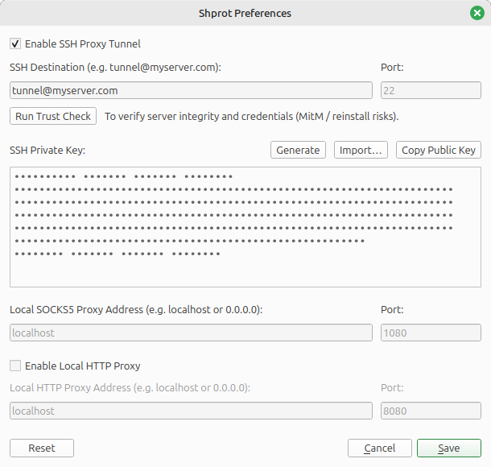

<h1> Shprot</h1>

🌐 **Languages:** [**English**](README.md) | [Русский](README.ru.md) | [简体中文](README.zh.md)

**Shprot** is a desktop application that gives you a reliable, auto-recovering SOCKS5 proxy over SSH — without touching the command line.

Unlike standard SSH tunneling tools, it watches your network, automatically restarts broken connections, and even adapts when you switch Wi-Fi or wake your PC from sleep. Built-in SSH key generation and flexible proxy settings make it easy to set up and secure.

Whether you're a developer, tester, or just need a stable proxy for daily browsing, Shprot keeps your connection alive with minimal effort.

## ✨ Features

- **Automated SSH Tunneling:** Easily establish and manage secure SSH tunnels that route traffic through a local SOCKS5 proxy.
- **Smart Connection Resilience:** Automatically monitors internet status and network switches (e.g., changing Wi-Fi networks or waking from sleep) and transparently restarts the tunnel.
- **Advanced Health Checks:** Periodically verifies connection integrity by testing popular website availability through the proxy, reviving the tunnel instantly if the underlying SSH process stalls.
- **Server-Friendly Reconnection:** Repeated restart attempts are spaced out with a growing delay, and authentication failures are retried no more than once a minute (backing off up to 30 minutes), so a misconfigured key will not get your IP address banned by tools like fail2ban.
- **Integrated Key Management:** Simplifies client authentication with built-in SSH key generation, allowing you to easily copy your public key to the remote server's `authorized_keys`.
- **User-Friendly Authentication:** Provides a clean interface for managing remote server credentials and server/client authentication parameters.
- **Configurable Network Settings:** Full control over the local binding address and port settings for your SOCKS5 proxy server.
- **Optional HTTP Proxy Support:** In addition to the SOCKS5 proxy, you can enable a separate HTTP proxy that routes traffic through the same SSH tunnel. This is useful for legacy applications or scripts that only support HTTP proxies.
  
## 🤔 Why Not Just `ssh -D`?

`ssh -D 1080 user@server` gives you a SOCKS5 proxy in one command — until the connection silently stops working. Shprot runs the same OpenSSH client and takes care of everything the command alone doesn't:

| | `ssh -D` | Shprot |
|---|---|---|
| Network change, Wi-Fi switch, wake from sleep | Restart it yourself | Reconnects automatically |
| Tunnel connected but not passing traffic | Goes unnoticed | Detected by health checks through the proxy |
| Repeated authentication failures | Up to your scripts | Rare retries, so the server doesn't ban your IP |
| Client keys | `ssh-keygen` and files in `~/.ssh` | Generate or import, copy the public key in one click |
| Server identity check | Terminal prompt | Dialog with the host key fingerprint |
| Apps without SOCKS5 support | Not covered | Optional HTTP proxy through the same tunnel |
| Tunnel status | Terminal window | Tray icon and notifications with the failure reason |

Tools like `autossh` help with restarts, but still need manual setup and have no user interface.

**Typical uses:**

- **Your own infrastructure:** reach internal dashboards, staging environments and admin tools that are only accessible from your server's network.
- **Untrusted networks:** send your traffic through your own server when using public Wi-Fi in cafés, hotels or airports.
- **Remote work on a laptop:** keep a stable proxy on a machine that sleeps and changes networks all day.

## 💻 System Requirements

Shprot is available for **Windows** and **Linux** platforms:

- **Windows:** Windows 10 / 11 (64-bit)
- **Linux (DEB-based):** Ubuntu 22.04 or newer, Debian 12 or newer, and other compatible distributions
- **Linux (RPM-based):** Fedora 39 or newer, RHEL 9 / AlmaLinux 9 or newer
- **All platforms:** OpenSSH client (`ssh` and `ssh-keygen`). On Windows it is usually installed already; if not, add **"OpenSSH Client"** in Windows Settings, *Optional features*. On Linux, install the `openssh-client` package (Ubuntu/Debian) or `openssh-clients` (Fedora/RHEL). Shprot warns you if the client is missing.

## 🚀 Installation

Shprot is available for both Windows and Linux platforms. Choose the appropriate package for your operating system from the **[Releases](../../releases)** section.

### Windows
Download the pre-compiled NSIS installer for Windows (`.exe` file). Simply run the downloaded file and follow the setup wizard instructions.

### Linux (DEB-based distributions)
For Ubuntu, Debian, and other DEB-based systems, download the `.deb` package and install it using:

    sudo dpkg -i shprot_*.deb
    sudo apt-get install -f  # Resolve any dependency issues

The package is built on Ubuntu 22.04 and should work on all newer versions of Ubuntu, Debian 12+, and compatible distributions.

### Linux (RPM-based distributions)
For Fedora, RHEL, AlmaLinux, and other RPM-based systems, download the `.rpm` package and install it using:

    sudo rpm -i shprot-*.rpm

Or on Fedora/RHEL with DNF:

    sudo dnf install ./shprot-*.rpm

The package is built on Fedora 39 and should work on Fedora 39+, RHEL 9+, AlmaLinux 9+, and compatible distributions.

### Verifying the Download
Every release includes a `SHA256SUMS` file with checksums of all packages. Download it next to your package and check that the package was not altered:

- **Linux:**

      sha256sum -c SHA256SUMS --ignore-missing

- **Windows (PowerShell):** compare the output with the line for your file in `SHA256SUMS`:

      Get-FileHash .\Shprot-*.exe -Algorithm SHA256

## 🖥️ Server-Side Setup (Secure Hardening)

To ensure maximum security, it is highly recommended to create a dedicated, restricted user on your remote Linux server (e.g., Ubuntu/Debian) specifically for SSH tunneling. This prevents the tunneling account from accessing a command shell or executing arbitrary scripts on your server.

Follow these steps to configure your server:

### 1. Create a Restricted User
Run the following command to create a system user named `tunnel` with no login shell and a locked home directory:

    sudo useradd -r -s /bin/false -m tunnel

### 2. Configure SSH Daemon
Open the SSH configuration file with root privileges:

    sudo nano /etc/ssh/sshd_config

Scroll to the very bottom of the file and append the following `Match User` block. This explicitly isolates the `tunnel` user, disables interactive terminal allocation, and allows only TCP forwarding:

    Match User tunnel
        AllowTcpForwarding yes
        X11Forwarding no
        PermitTTY no
        ForceCommand echo "This account is for SSH tunneling only."

*Save the file and restart the SSH service to apply the changes: `sudo systemctl restart ssh`.*

### 3. Add Your Shprot Public Key
Now, install the public key generated by Shprot into the new user's environment. Switch to root or use `sudo` to set up the authorized keys file:

    # Create the .ssh directory with correct permissions
    sudo mkdir -p /home/tunnel/.ssh
    sudo chmod 700 /home/tunnel/.ssh

    # Append your Shprot public key
    echo "your-shprot-public-key-here" | sudo tee -a /home/tunnel/.ssh/authorized_keys

    # Fix ownership and permissions
    sudo chmod 600 /home/tunnel/.ssh/authorized_keys
    sudo chown -R tunnel:tunnel /home/tunnel/

Once configured, use `tunnel` as the **SSH username** (and leave the Port field as `22` unless your server uses a custom port) when setting up the connection in the Shprot desktop application.

## 🔧 Application Configuration

Shprot operates completely independently of your system's global SSH configurations or pre-existing user keys, relying solely on its internal settings for enhanced isolation and security.

    <picture>
        <source media="(prefers-color-scheme: dark)" srcset="Assets/Screenshot-Dark.png">
        <source media="(prefers-color-scheme: light)" srcset="Assets/Screenshot-Light.png">
        
    </picture>

Follow these steps to configure the proxy tunnel:

### Step 1: Enable the Tunnel
1. Check the **"Enable SSH Proxy Tunnel"** checkbox. 
   * *Note: All other configuration controls remain safely disabled until this is checked. You can uncheck it at any time to temporarily disable the tunnel without losing your settings.*

### Step 2: Configure Remote Server (SSH Destination)
1. In the **"SSH Destination"** field, enter your connection details using the format: `username@host` (for example, `tunnel@192.0.2.1`).
2. In the **"Port"** field, specify the port number for the SSH connection. The default value is `22`, which is the standard SSH port. You only need to change this if your server listens on a non-standard port.
3. *(Optional)* Click the **"Run Trust Check"** button below. This tests whether Shprot already trusts the host key. You can use this button later for manual troubleshooting if your server was reinstalled or if you suspect a network anomaly.

### Step 3: Set Up Client Key Authentication
1. Go to the **"SSH Private Key"** area. To provide a secure client key, you can:
   * Paste an existing private key text into the field.
   * Click **"Import…"** to load a key from a file.
   * Click **"Generate"** (Highly Recommended) to let Shprot instantly create a fresh cryptographic key pair.
2. Click **"Copy Public Key"** to copy the generated public key text to your clipboard.
3. Open your server terminal and append this key to the restricted user's file as shown in the Server Setup section.

### Step 4: Configure the Local SOCKS5 Proxy
1. Review the proxy routing parameters:
   * **Local SOCKS5 Proxy Address:** Defaults to `localhost` (restricts traffic to your local computer). Change it to `0.0.0.0` if you want to share the proxy with other devices in your LAN.
   * **Port:** Defaults to `1080`. You can change this if `1080` is already occupied by another service on your system.

> ⚠️ **Security note:** The proxy has no authentication. With `0.0.0.0` (or any other non-loopback address), anyone who can reach this port can use your SSH tunnel. Shprot asks for confirmation when you save such an address. Share the proxy only on trusted networks and consider restricting access with a firewall.

### Step 5: Optional Local HTTP Proxy (Advanced)
If you need an HTTP proxy in addition to the SOCKS5 one, check the **"Enable Local HTTP Proxy"** checkbox. This will unlock the following two controls:

- **Local HTTP Proxy Address:** By default, this is set to `localhost` (same as SOCKS5). Change it to `0.0.0.0` to share the HTTP proxy with other devices on your LAN.
- **Port:** Defaults to `8080`. You can change it if this port is already in use.

The security note from Step 4 applies to the HTTP proxy as well: it has no authentication either.

The HTTP proxy works **through** the same SSH tunnel as the SOCKS5 proxy, so it does not require any additional server-side configuration. Once you enable it, both proxies will be available simultaneously.

### Step 6: Save and Establish Connection
1. Click the **"Save"** button. Shprot will automatically validate all fields. If any errors are found, the app will highlight the invalid fields and guide you on what to fix.
2. **Host Verification (First-time Connection):**
   If you are connecting to this server for the first time, a dialog box will appear displaying the remote server's **host key fingerprint**. 
   * *💡 Tech Tip (How to verify): To prevent Man-in-the-Middle attacks, you can verify this fingerprint by running `ssh-keygen -lf /etc/ssh/ssh_host_ed25519_key.pub` (or your specific host key file) directly on your server console and matching the output hash.*
3. Confirm trust in the dialog box. Shprot will save your parameters and immediately spin up the background engine to open and maintain the tunnel.

### 📊 Connection Status Indicators
You can easily track the tunnel status without opening the main window:
* **System Tray Icon:** A vibrant, **colored icon** means the tunnel is active and the SOCKS5 proxy is successfully serving traffic. A **grayscale icon** indicates that the tunnel is closed or disconnected.
* **Tray Icon Tooltip:** Hover over the tray icon to see the current tunnel state and, if the tunnel is closed, the reason (for example, an authentication failure or an unreachable server).
* **Toast Notifications:** The app will send native system tray notifications whenever the tunnel successfully connects or drops. If the tunnel cannot be opened, the notification explains why; each new reason is reported once rather than on every reconnection attempt.

## 🛠 Building and Development

### 1. Pre-requisites & Setup

Before building or opening the project, ensure you have the following environment configuration:

- **OS:** Windows 10/11 (64-bit) or Linux (Ubuntu 22.04+, Fedora 39+)
- **Compiler:** 
  - Windows: MSVC 2022 (x64)
  - Linux: GCC 11 or newer (or Clang 14+)
- **Framework:** Qt 6.11.2
- **Build System:** CMake (version 3.20 or higher)
- **Build Generator:** Ninja (highly recommended for faster compilation times) or MSBuild
- **Installer Generators:** 
  - Windows: NSIS
  - Linux: Custom scripts using `fakeroot`/`dpkg-deb` (for DEB) and `rpmbuild` (for RPM)

Follow these steps to clone the repository:

    git clone https://github.com/andrew-markin/shprot.git
    cd shprot

### 📦 Option A: Building the Release Package

The project uses environment variables for configuration via a `.env` file. Copy the example environment file:

    cmake -E copy .env.example .env

Open the newly created `.env` file and set the `QT_PREFIX` variable to point to your local Qt 6.11.2 installation:

- **Windows (MSVC):**

      QT_PREFIX=C:\Users\YourUsername\Qt\6.11.2\msvc2022_64

- **Linux (native build only):**

      QT_PREFIX=/home/yourusername/Qt/6.11.2/gcc_64

> **Note:** The `.env` file is primarily required for Windows builds. For Linux, it's recommended to use Docker-based builds (see below), which do not require a local Qt installation.

#### Windows Build
Run the automated release script from the project root directory:

    ReleaseWindows.cmd

Once the script finishes execution, you can find the production-ready NSIS installer (`.exe`) inside the **`Release`** folder.

#### Linux Build (Recommended: Docker-based)

Building Linux packages is done using Docker to ensure consistency and reproducibility. This approach creates clean, isolated build environments with all necessary dependencies pre-configured.

**Prerequisites:** Install [Docker](https://docs.docker.com/engine/install/) on your development machine.

**Available build scripts:**

1. **For DEB-based distributions (Ubuntu 22.04+):**

       ./ReleaseUbuntu.sh

Produces a `.deb` package using `dpkg-deb`, compatible with Ubuntu 22.04 and newer, Debian 12 and newer.

2. **For RPM-based distributions (Fedora 39+):**

       ./ReleaseFedora.sh

Produces an `.rpm` package using `rpmbuild`, compatible with Fedora 39 and newer, RHEL 9 / AlmaLinux 9 and newer.

**Important notes about Docker builds:**

- **First build takes time:** The initial run of either script typically takes **10 to 40 minutes**, depending on your CPU and network speed, as it builds Docker images and compiles a lightweight, customized version of Qt 6.11.2 from source. This is a one-time setup.
- **Subsequent builds are fast:** After the Docker images are cached locally, all following builds will be significantly faster (typically a few minutes).
- **No local Qt required:** Since Qt is bundled inside the Docker containers, you don't need to configure `.env` or install Qt on your host system.
- **Output location:** All generated packages (`.deb` or `.rpm`) will appear in the **`Release`** folder, just like the Windows installer.
- **Updating builder images:** The scripts build a Docker image only if it does not exist yet. After `Dockerfile.ubuntu` or `Dockerfile.fedora` changes, remove the old image (`docker rmi shprot-ubuntu-builder` or `docker rmi shprot-fedora-builder`) so that the next run rebuilds it.
- **Qt sources mirror:** Qt sources are downloaded from the Yandex mirror by default. To use another mirror, build the image manually, for example:

      docker build --build-arg QT_MIRROR=https://download.qt.io -t shprot-ubuntu-builder - < Dockerfile.ubuntu

#### Linux Build (Alternative: Native)

If you prefer to build natively without Docker, you can do so by installing the required build dependencies and configuring `.env` with your local Qt path.

**Required packages:**

- **Ubuntu/Debian:**

      sudo apt-get install build-essential cmake fakeroot dpkg-dev file ninja-build patchelf

- **Fedora/RHEL:**

      sudo dnf install cmake file gcc-c++ make ninja-build patchelf rpm-build

After installing dependencies and setting `QT_PREFIX` in `.env`, you can build using CMake directly. However, **Docker-based builds are strongly recommended** as they produce more consistent, portable packages.

### 💻 Option B: Working with Code (Development)

If you want to modify the code, fix bugs, or add features, you should use **Qt Creator**:

1. Open **Qt Creator**.
2. Select **Open Project** and navigate to the **`Sources`** directory.
3. Open the **`CMakeLists.txt`** file located inside the `Sources` folder.
4. When prompted to configure the project, select your local **Qt 6.11.2** kit configured in your IDE.
   - *Tip: For much faster build times, we highly recommend using **Ninja** as the CMake generator in your Kit settings instead of the default generator.*
5. Set the **Build directory** to point to the **`Builds`** folder in the project root (e.g., `../Builds/build-Shprot-Desktop-Debug`).

For Linux development, you can use the same Docker-based approach or install Qt 6.11.2 natively on your system.

Now you can write code, debug, and run the application directly from the IDE. Intermediate build files will be kept safe inside the `Builds` folder.

### 🧪 Running Tests

Unit tests (Qt Test) cover utility functions and the HTTP proxy. They are not built by default; enable them with the `SHPROT_BUILD_TESTS` CMake option:

    cmake -S Sources -B Builds/Tests -DCMAKE_PREFIX_PATH=<path to Qt 6.11.2> -DSHPROT_BUILD_TESTS=ON
    cmake --build Builds/Tests --target TestUtilities TestHttpProxy --parallel
    ctest --test-dir Builds/Tests --output-on-failure

On Windows with the Visual Studio generator, add `--config Release` to the build command and `-C Release` to the `ctest` command.

### 🤖 Automated Builds and Releases

The repository includes a GitHub Actions workflow (`.github/workflows/build.yml`) that builds the Windows installer and the DEB and RPM packages on every push to `main` and for every pull request. Unit tests are run on all three platforms as a part of the same workflow, and the resulting packages are available as workflow artifacts.

To publish a release:

1. Bump the version in `Sources/CMakeLists.txt` (`project(Shprot VERSION X.Y ...)`).
2. Create and push a matching tag, for example `git tag v1.5 && git push origin v1.5`. The workflow stops immediately if the tag does not match the project version.
3. Once all builds succeed, a **draft** release with the three packages and auto-generated release notes appears on the Releases page. Review it and publish it manually.

Docker builder images are cached in GitHub Container Registry (`ghcr.io`) and rebuilt only when a Dockerfile changes, so only the first run and runs after Dockerfile changes take long.

## 🤝 Contributing

We welcome contributions to Shprot! To get started:

1. **Fork** the repository and clone your fork locally.
2. Create a **new branch** for your changes (`git checkout -b feature/amazing-feature`).
3. Make sure your environment is configured correctly as described in the development section above.
4. Commit your changes (`git commit -m 'Add some amazing feature'`) and push them to your fork (`git push origin feature/amazing-feature`).
5. Open a **Pull Request** against our main repository.

*Before starting any major work, please open an [Issue](../../issues) first to discuss your ideas with the maintainers.*

## 📜 License

This project is licensed under the terms of the **GNU GPL v3** license. 

For the full license text, please see the accompanying [LICENSE](LICENSE) file in the root directory of this repository. You are free to redistribute and/or modify this software under the conditions outlined in the GPL v3.
